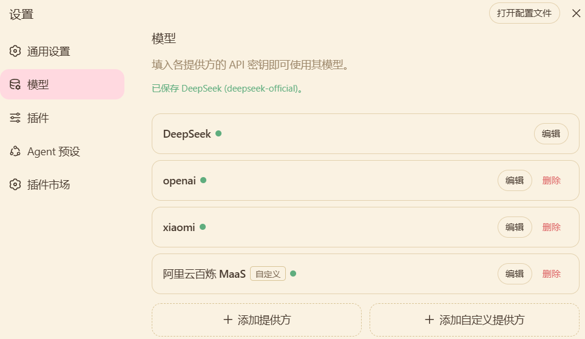
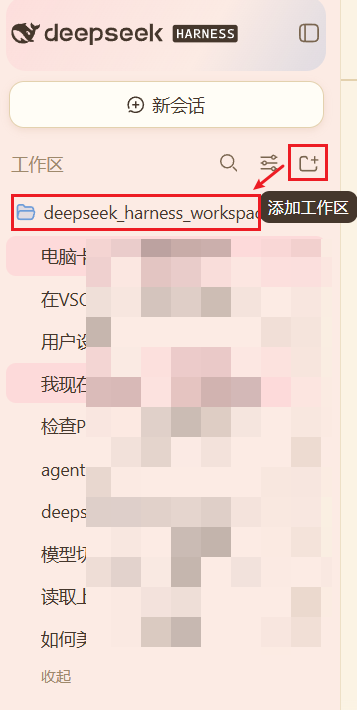
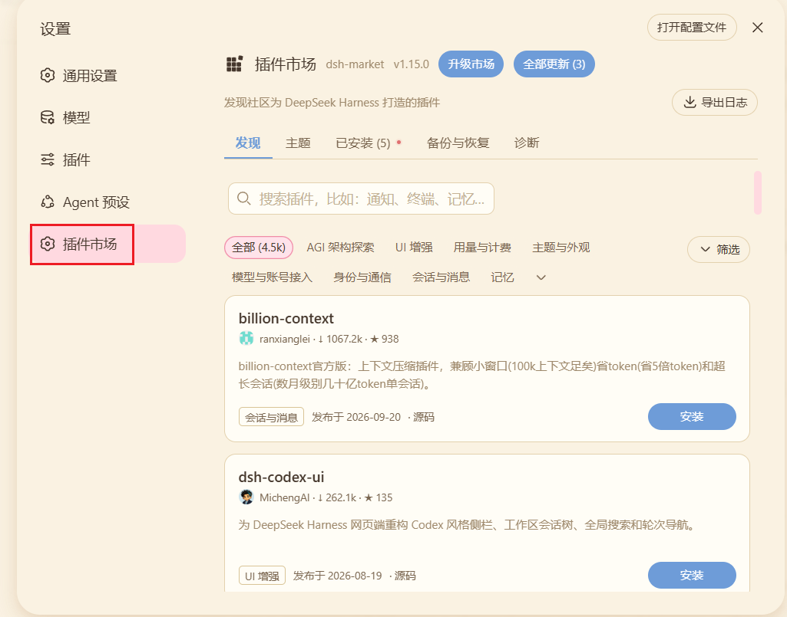

+++
title = 'DeepSeek Harness（DSH）技术调研'
date = '2026-10-15T15:41:01+08:00'
draft = false
tags = ['DSH', 'AI Agent', 'DeepSeek']
slug = 'dsh-research'
+++

# DeepSeek Harness（DSH）技术调研

> 本文是对 DeepSeek Harness（DSH）的完整技术调研记录：从项目定位与核心架构出发，梳理环境准备、三种安装方式、模型与工作目录配置、日常使用、插件扩展机制、典型研发应用场景以及安全与版本限制，适合零基础使用者、Java 开发工程师、AI 应用开发人员和插件开发人员参考。

> **文档版本：** V1.0
> **调研日期：** 2026年10月
> **适用对象：** 零基础使用者、Java 开发工程师、AI 应用开发人员、插件开发人员
> **调研目标：** 了解 DSH 的定位、安装方式、基础使用方法、插件扩展机制及实际研发应用场景，形成可复现的入门和验证流程。

## 一、🎯 调研背景与目标

### 1.1 📖 调研背景

随着大语言模型和 AI Agent 技术的发展，AI 的应用已经从简单的问答交互，逐步扩展到调用工具、读取文件、执行代码、分析项目和完成多步骤任务。

在实际研发过程中，如果只使用普通的 AI 对话工具，往往需要开发人员手动组织上下文、选择工具、执行操作，并根据执行结果反复调整提示词。

Agent Harness 提供了一种不同的思路：将模型、工具、任务执行流程、会话管理和扩展能力组织在统一的运行环境中，使智能体能够根据任务调用相应能力，并支持开发者通过插件进行扩展。

DeepSeek Harness（简称 DSH）是 DeepSeek 开源的此类框架之一。本次调研主要围绕其架构、使用方式和扩展能力展开。

### 1.2 🎯 调研目标

本次调研需要回答以下问题：

1. DSH 是什么，能够解决哪些问题？
2. DSH 与大模型、AI Agent、工作流之间有什么关系？
3. 如何在 Windows 环境中安装并运行 DSH？
4. 如何配置模型、选择工作目录并完成基本任务？
5. DSH 的插件机制是什么，如何扩展现有能力？
6. 如何开发自己的插件并将其安装到 DSH？
7. DSH 能否用于代码分析、单元测试生成、自动化研发等场景？
8. DSH 有哪些限制，适合在哪些场景中使用？

### 1.3 🧱 调研范围

本次调研分为五个层次：

| 层次 | 调研内容 | 预期结果 |
| --- | --- | --- |
| 基础认知 | 定位、架构、核心概念 | 理解 DSH 的工作方式 |
| 环境搭建 | Node.js、命令行、源码部署 | 能够独立启动 DSH |
| 日常使用 | 模型配置、工作目录、任务执行 | 能够完成基础 Agent 任务 |
| 插件扩展 | 本地插件、Bundle、工具扩展 | 能够增加自定义能力 |
| 应用验证 | 研发场景、自动化流程、安全与限制 | 评估实际落地价值 |

## 二、🧭 DeepSeek Harness 是什么？

### 2.1 📖 基本定义

DeepSeek Harness 是 DeepSeek 开源的 Agent Harness 框架，项目采用插件化架构，并以 Cordis 作为底层插件框架。

官方项目地址：

- GitHub：[https://github.com/deepseek-ai/deepseek-harness](https://github.com/deepseek-ai/deepseek-harness)
- 官方文档：[https://deepseek-harness.github.io/deepseek-harness/](https://deepseek-harness.github.io/deepseek-harness/)
- npm 包：[https://www.npmjs.com/package/@deepseek-ai/dsh](https://www.npmjs.com/package/@deepseek-ai/dsh)
- 官方项目 README：[https://github.com/deepseek-ai/deepseek-harness/blob/master/README.md](https://github.com/deepseek-ai/deepseek-harness/blob/master/README.md)

需要注意，DSH 本身不是大语言模型。它提供的是组织和运行智能体所需的基础设施，实际的推理能力仍然来自配置的大模型或模型服务。

### 2.2 🧩 DSH 解决什么问题？

以自动生成 Java 单元测试为例，传统方式通常是：

1. 开发人员找到需要测试的 Java 类。
2. 将代码复制给 AI。
3. 编写提示词，要求 AI 生成测试代码。
4. 将生成的代码复制到项目中。
5. 手动运行测试。
6. 分析测试失败原因。
7. 继续向 AI 提供错误信息并修改代码。

这种方式虽然能够利用大模型，但开发人员仍需要手动完成大量衔接工作。

如果将其组织为 Agent 任务，则可以尝试形成以下流程：

**接收任务 → 分析代码 → 读取项目结构 → 生成测试代码 → 执行测试 → 分析失败原因 → 修改并再次验证 → 输出结果。**

DSH 的价值在于提供一个可组合、可扩展的运行框架，让模型、工具和执行逻辑能够协同工作。实际能否自动完成上述每个步骤，还取决于安装的插件、模型能力、权限配置和任务设计。

### 2.3 🔗 DSH 与大模型、AI Agent、工作流的关系

| 概念 | 核心作用 | 示例 |
| --- | --- | --- |
| 大语言模型（LLM） | 理解、推理、生成内容 | 根据 Java 代码生成测试用例 |
| AI Agent | 根据目标选择行动，并根据结果继续执行 | 读取代码、运行测试、修复失败 |
| 工作流（Workflow） | 按预先设计的步骤执行任务 | 固定执行代码扫描、测试、报告生成 |
| Agent Harness | 提供运行智能体、组合插件和接入工具的基础设施 | DSH 组织模型、工具、会话和执行流程 |

可以将它们理解为：

- 大模型负责提供智能能力。
- Agent 负责围绕目标进行任务决策和行动。
- 工作流负责组织任务步骤。
- Harness 为 Agent 提供可运行、可扩展的技术环境。

这些概念并非互相替代的关系。一个 Agent 可以使用工作流，一个 Harness 也可以运行不同类型的智能体。

## 三、🏗️ DSH 的核心架构与关键概念

### 3.1 🏗️ 整体架构

DSH 的核心设计思想是 Everything is a Plugin，即尽可能将系统能力组织为插件，而不是将所有功能写死在一个庞大的核心程序中。

可以用下面的逻辑结构理解：

```text
用户 / 开发人员
       |
       v
  DSH Web UI / CLI
       |
       v
   Profile 运行配置
       |
       v
 插件组合与配置加载
       |
       v
+---------------------------+
| Agent 执行与会话管理       |
| 模型适配与工具注册         |
| 文件访问与其他扩展能力     |
+---------------------------+
       |
       v
 模型服务 / 本地文件 / 外部工具
```

以上是便于理解的逻辑示意，不代表所有组件严格按照单一调用顺序运行。

### 3.2 🧠 核心概念

#### （1）🧩 Plugin：插件

插件是 DSH 扩展功能的基本单位。插件可以注册服务、工具、事件监听或其他能力。

例如：

- 注册一个代码分析工具。
- 增加一个访问内部 HTTP 接口的工具。
- 增加特定业务的上下文处理逻辑。
- 扩展会话或其他运行能力。

#### （2）🧵 Cordis：插件框架

Cordis 是 DSH 底层的插件框架，负责插件加载、依赖关系、服务注册和生命周期管理。

插件通常通过 apply(ctx) 入口接收运行上下文 ctx，再通过上下文注册所需能力。

#### （3）🎛️ Profile：运行配置

Profile 可以理解为一套独立的运行环境配置，决定本次启动组合哪些插件包，以及采用哪些用户配置。

例如，可以分别创建：

- web：Web 界面使用环境。
- headless：无界面的一次性任务环境。
- 自定义 Profile：针对某个特定用途组织插件和配置。

不同 Profile 的可用能力取决于其实际配置和版本。

#### （4）📦 Bundle：插件组合包

Bundle 是一种可安装、可分发的插件配置包。它不仅可以包含插件代码，还可以携带用于注册和组合插件的配置层。

可以将 Plugin 理解为功能单元，将 Bundle 理解为一种可安装的功能组合与配置分发形式。

#### （5）🩹 Patch：配置覆盖层

Patch 用于插入或覆盖插件配置。通过不同配置层，可以在不直接修改 DSH 核心源码的情况下增加或调整能力。

#### （6）🌐 Context：运行上下文

ctx 是插件访问运行时服务的重要入口。例如，插件可以通过上下文访问已经注册的工具服务，或者向上下文注册自己的服务。

### 3.3 ⚡ DSH 的扩展机制有什么特点？

传统扩展方式可能需要直接修改原项目源码，再重新构建和发布。

DSH 的插件化方式允许开发者在独立目录开发插件，通过配置覆盖或 Bundle 的方式接入运行环境。

这种方式的优点包括：

- 减少直接修改核心代码的需求。
- 便于将不同功能拆分为独立模块。
- 便于独立调试、升级和移除扩展。
- 有利于团队复用已有插件。

但插件化并不意味着没有兼容性问题。插件仍可能依赖特定版本的接口、运行时和其他插件，需要做好版本管理与回归测试。

官方架构文档：[https://github.com/deepseek-ai/deepseek-harness/blob/master/docs/architecture.md](https://github.com/deepseek-ai/deepseek-harness/blob/master/docs/architecture.md)

## 四、⚙️ 环境准备与安装方式

DSH 提供三种主要入门方式：通过 npx 直接启动、通过 npm 下载，以及克隆源码后在本地运行。

建议首次接触 DSH 的人员先采用第一种方式，完成基础验证后，再进入源码和插件开发。

### 4.1 📋 环境要求

| 环境 | 用途 | 说明 |
| --- | --- | --- |
| Windows 10/11 | 操作系统 | 本指南以 Windows 为例 |
| Node.js | 运行 DSH | 需满足当前版本声明的 Node.js 引擎要求 |
| npm / npx | 下载和启动包 | 通常随 Node.js 安装 |
| Git | 获取源码 | 仅源码部署需要 |
| pnpm | 安装源码依赖 | 仅源码开发需要 |
| 模型 API Key | 调用云端模型 | 具体取决于选择的模型提供商 |
| 网络连接 | 下载依赖和访问模型服务 | 需满足实际网络与代理要求 |

**版本注意事项： DSH 处于快速迭代阶段。当前官方 npm 包的 Node.js 引擎要求应以所选版本的 package.json 为准。官方近期版本声明包含 Node.js ^22.19.0 || >=24.0.0；不要默认认为旧版 Node.js 一定兼容。**

### 4.2 🟩 安装 Node.js

#### 1️⃣ 第一步：访问 Node.js 官方网站。

[https://nodejs.org/](https://nodejs.org/)

#### 2️⃣ 第二步：安装符合当前 DSH 版本要求的 Node.js。

#### 3️⃣ 第三步：打开 PowerShell，检查安装结果：

```powershell
node --version
npm --version
```

如果能够输出版本号，说明基本环境已就绪。

如果提示无法识别 node 或 npm，应检查是否安装成功，以及环境变量 PATH 是否包含 Node.js 安装目录。必要时重新打开终端。

### 4.3 ⚡ 方式一：通过 npx 直接启动

这是推荐的零基础入门方式。

在 PowerShell 中执行：

```powershell
npx @deepseek-ai/dsh web
```

执行后，DSH 会下载所需的 npm 包并启动 Web 界面。正常情况下，默认访问地址为：

```text
http://127.0.0.1:3080
```

首次启动需要下载依赖，等待时间可能较长。应以终端实际输出为准。

如果需要手动打开浏览器，可以执行：

```powershell
npx @deepseek-ai/dsh web --no-open
```

如果默认端口被占用，可以尝试：

```powershell
npx @deepseek-ai/dsh web --port 8080
```

**这种方式的特点：**

- 无需手动克隆 GitHub 仓库。
- 无需自己执行 pnpm install 和构建。
- 适合初次体验、基础功能验证和普通使用。
- 首次启动需要能够访问 npm 包源。
- 不适合作为完整的源码修改和插件开发环境。

关闭 DSH 时，在运行命令的终端按 Ctrl+C。

### 4.4 📦 方式二：通过npm下载

长期使用可通过npm下载

```powershell
npm install -g @deepseek-ai/dsh
dsh --version
```

启动命令：

```powershell
dsh web
```

|  | npm install -g @deepseek-ai/dsh | npx @deepseek-ai/dsh |
| --- | --- | --- |
| 装到哪 | 全局前缀 D:\\nodejs\\node_modules\\@deepseek-ai\\dsh | npx 临时缓存 _npx\\<哈希>\\ |
| 启动命令 | dsh（短、永久） | npx @deepseek-ai/dsh（每次打全串） |
| 留命令垫片 | ✅ 生成 dsh / dsh.cmd / dsh.ps1 | ❌ 不生成 |
| 后续启动 | 直接跑本地 lib/bin.js，不联网 | 通常仍要联系 registry 解析版本 |
| 断网能用 | ✅ 能 | ⚠️ 缓存没命中时不能 |
| 版本 | 锁定，你不升级就不变 | 可能拿到更新的版本，行为可能突变 |

### 4.5 🧬 方式三：克隆源码并本地运行

如果需要研究内部实现、修改代码或开发插件，建议使用源码方式。

官方仓库：

[https://github.com/deepseek-ai/deepseek-harness](https://github.com/deepseek-ai/deepseek-harness)

#### 1️⃣ 第一步：选择独立目录

不要直接在存放大量现有 Git 项目的公共目录中运行项目级安装命令。

例如，如果已有目录 E:\workspace 存放其他 Git 项目，建议为 DSH 单独创建目录：

```powershell
New-Item -ItemType Directory -Path E:\ai-lab -Force
Set-Location E:\ai-lab
```

#### 2️⃣ 第二步：克隆仓库

```powershell
git clone https://github.com/deepseek-ai/deepseek-harness.git
Set-Location .\deepseek-harness
```

#### 3️⃣ 第三步：安装 pnpm

先检查是否已经安装：

```powershell
pnpm --version
```

如果提示无法识别命令，可以使用 npm 安装：

```powershell
npm install -g pnpm
```

完成后重新打开终端并检查版本。

#### 4️⃣ 第四步：安装项目依赖

在 deepseek-harness 仓库根目录执行：

```powershell
pnpm install
```

该命令会根据项目清单安装开发所需依赖。

#### 5️⃣ 第五步：构建项目

```powershell
pnpm run build
```

构建过程会生成运行所需的项目产物。如果构建失败，应先解决依赖、版本或编译错误，不要直接跳过构建步骤。

#### 6️⃣ 第六步：启动 Web 界面

```powershell
pnpm dsh web
```

然后访问终端输出的地址，通常为：

```text
http://127.0.0.1:3080
```

这套命令与 npm 启动方式的主要区别是：源码模式需要先安装依赖和构建，适合后续开发和调试。

### 4.6 ⚖️ 几个命令的区别

| 命令 | 作用 |
| --- | --- |
| npx @deepseek-ai/dsh web | 获取 npm 包并启动 Web 环境 |
| git clone ... | 下载项目源代码 |
| pnpm install | 安装源码项目依赖 |
| pnpm run build | 执行项目定义的构建脚本 |
| pnpm dsh web | 在源码项目环境中启动 DSH |
| pnpm run dev:web | 开发模式，适合研究和调试 Web 前端；具体行为以当前源码脚本为准 |

注意：pnpm install 和 pnpm run build 应在 DSH 仓库目录中执行，不要在 E:\workspace 这样的公共父目录中执行。否则可能在父目录产生依赖清单、锁文件或其他构建相关文件，影响现有项目管理。

## 五、🚀 首次使用：配置模型并完成第一个任务

完成安装并打开 Web 界面后，还需要配置模型和工作目录，才能开展实际任务。

### 5.1 🤖 配置模型

进入 DSH 的设置页面，找到模型相关配置。

对于 DeepSeek 提供商，一般需要填写 API Key 并保存；对于其他模型提供商，则根据界面支持情况配置相应的凭据、模型和服务参数。

官方模型配置指南：

[https://deepseek-harness.github.io/deepseek-harness/guide/providers](https://deepseek-harness.github.io/deepseek-harness/guide/providers)

配置时需要注意：

1. 确认模型提供商与 API Key 匹配。
2. 确认所选模型能够正常访问。
3. 不要将 API Key 写入公开仓库或提交到 Git。
4. 检查网络、代理、配额和模型服务权限。
5. 使用内部模型服务时，应遵循公司规定的接口和数据安全要求。

不同版本的界面可能有所变化，具体以实际运行版本为准。



### 5.2 📁 配置工作目录

Agent 如果需要分析代码，就必须知道可以访问哪个项目目录。

建议初次测试时创建一个独立的练习目录，例如：

```text
E:\ai-lab\dsh-demo
```

其中可以放置用于验证的示例代码、文档或测试文件。

首次测试不要直接开放整个工作盘或包含敏感信息的生产项目。应先确认 DSH 的文件访问范围和执行权限，再逐步扩大工作范围。



### 5.3 ✅ 完成第一个任务

在 DSH 的交互界面中，可以尝试以下任务：

#### 1️⃣ 任务一：分析项目结构

```text
请分析当前工作目录的项目结构。

要求：
1. 识别主要目录和配置文件。
2. 总结项目的主要功能。
3. 找出可能的入口文件。
4. 仅进行分析，不修改任何文件。
5. 对不确定的信息明确说明。
```

#### 2️⃣ 任务二：分析 Java 类

```text
请阅读当前项目中的指定 Java 类。

要求：
1. 总结类的职责。
2. 梳理主要方法及其调用关系。
3. 找出潜在异常处理问题。
4. 分析可能的性能瓶颈。
5. 仅输出分析报告，不修改代码。
```

#### 3️⃣ 任务三：生成单元测试方案

```text
请为指定 Java 类制定单元测试方案。

要求：
1. 识别正常输入、边界输入和异常输入。
2. 识别外部依赖和需要 Mock 的对象。
3. 给出测试用例清单。
4. 说明每个用例的预期结果。
5. 暂时只输出方案，不生成文件。
```

执行任务后，应重点检查：

- Agent 是否真正读取了目标文件。
- 输出是否引用了真实代码，而不是泛泛而谈。
- 如果任务需要工具，工具是否实际执行。
- 是否产生了未经授权的文件修改。
- 是否能根据执行结果继续完成任务。

如果 Agent 只是给出文字建议，没有实际调用工具，就不能认为自动化执行链路已经验证成功。

## 六、🛠️ DSH 的日常使用方式

### 6.1 🖥️ Web 界面与命令行

DSH 可以通过 Web UI 使用，也支持不同 Profile 对应的命令行运行方式。

Web UI 更适合交互式任务，例如分析代码、查看结果、逐步调整任务要求。

命令行更适合脚本化和自动化调用，例如在终端执行一次性任务，或者将 Agent 接入其他研发工具。

### 6.2 ⌨️ 常用命令

以下命令适用于支持相应功能的当前版本：

```powershell
# 启动 Web UI
npx @deepseek-ai/dsh web

# 不自动打开浏览器
npx @deepseek-ai/dsh web --no-open

# 使用指定端口
npx @deepseek-ai/dsh web --port 8080

# 查看命令帮助
npx @deepseek-ai/dsh --help

# 查看 Web Profile 的默认配置
npx @deepseek-ai/dsh --profile web --dump-default-config

# 查看组合后的 Web Profile 配置
npx @deepseek-ai/dsh --profile web --dump-config

# 运行一次性任务，不启动 Web 服务
npx @deepseek-ai/dsh --profile headless "分析当前项目的目录结构"
```

说明：

- --profile 用于选择运行配置。
- web 是 Web Profile 的快捷入口。
- headless 用于一次性任务执行。
- --dump-default-config 和 --dump-config 用于检查配置组合结果。

命令行参数可能随版本变化。执行前建议使用当前安装版本的 --help 核实。

### 6.3 ✍️ 如何写好 Agent 任务提示词

建议使用明确的任务结构，而不是仅仅描述一个模糊目标。

例如：

```text
任务目标：
为 OrderService 生成单元测试。

项目背景：
当前项目使用 Java、JUnit 和 Mockito。

执行步骤：
1. 阅读 OrderService 及相关依赖。
2. 梳理正常、边界和异常场景。
3. 生成符合项目规范的测试代码。
4. 检查测试文件是否符合现有目录结构。
5. 执行测试并分析失败原因。
6. 汇总测试结果。

约束：
1. 不修改业务源代码。
2. 不删除已有测试。
3. 不执行数据库写入。
4. 未经确认，不安装新的依赖。
5. 所有修改必须限定在指定项目目录内。

最终输出：
变更文件清单、测试结果、失败原因、覆盖率数据（如果实际执行并获取到）。
```

其中最重要的是：任务目标明确、步骤可验证、操作边界清晰、输出结果可检查。

### 6.4 🔍 如何判断 Agent 是否真正完成了任务？

不能只看回答是否流畅。建议至少检查以下指标：

| 检查项 | 验证方式 |
| --- | --- |
| 文件读取 | 确认引用的类名、方法名与真实代码一致 |
| 工具调用 | 检查是否实际调用了对应工具 |
| 文件修改 | 检查 Git diff 或文件变更记录 |
| 测试执行 | 检查真实测试命令及退出状态 |
| 测试结果 | 区分通过、失败、跳过和未执行 |
| 覆盖率 | 读取实际覆盖率报告，不接受模型猜测值 |
| 安全边界 | 检查是否访问了未授权目录或服务 |

## 七、🧩 如何扩展 DSH 插件？

这是本次调研的重点。

### 7.1 🪜 插件扩展的四种层次

| 层次 | 扩展方式 | 适用场景 |
| --- | --- | --- |
| 第一层 | 修改提示词和现有配置 | 调整任务行为、约束和输出 |
| 第二层 | 编写本地插件并通过 Patch 加载 | 验证新工具、增加自定义逻辑 |
| 第三层 | 打包成 Bundle 并安装到 Profile | 复用、分发和长期维护 |
| 第四层 | 安装dsh的插件市场 | 现成插件多，安装简单易上手 |

建议先从第二层开始学习。直接修改核心源码通常不是第一选择。

### 7.2 🔌 第一种：通过 Patch 加载本地插件

官方插件开发教程：

[https://github.com/deepseek-ai/deepseek-harness/blob/master/docs/user/develop/basic/index.zh.md](https://github.com/deepseek-ai/deepseek-harness/blob/master/docs/user/develop/basic/index.zh.md)

以下是最小插件示例，目的是验证插件能否被加载，而不是实现完整业务功能。

#### 1️⃣ 第一步：创建插件文件

在源码仓库根目录创建以下结构：

```text
deepseek-harness/
└── scratch-plugin/
    ├── src/
    │   └── my-plugin.ts
    └── cordis.yml
```

#### 2️⃣ 第二步：编写插件

在 scratch-plugin/src/my-plugin.ts 中写入：

```typescript
import type { Context } from '@deepseek-ai/cordis'

export const name = 'hello-plugin'

export function apply(ctx: Context) {
  console.log('[hello-plugin] plugin loaded!')
}
```

代码说明：

- name 用于标识插件。
- apply(ctx) 是插件的加载入口。
- ctx 是插件运行上下文。
- console.log 用于验证插件是否被加载。

#### 3️⃣ 第三步：编写加载配置

在 scratch-plugin/cordis.yml 中写入：

```yaml
- insert:
    - id: hello
      name: '/absolute/path/to/deepseek-harness/scratch-plugin/src/my-plugin.ts'
```

这里的路径必须替换为本机真实的绝对路径。

例如，若项目位于 E:\ai-lab\deepseek-harness，就应将示例路径改为对应的 Windows 绝对路径，并检查当前版本对路径格式的处理方式。

#### 4️⃣ 第四步：启动并验证

在 DSH 仓库根目录执行：

```powershell
pnpm dsh web --patch ./scratch-plugin/cordis.yml
```

如果插件加载成功，终端应出现：

```text
[hello-plugin] plugin loaded!
```

此时说明本地插件已经被加载，但还不能据此认定插件已具备实际业务功能。

### 7.3 🛠️ 第二种：开发真正可调用的工具

如果需要让 Agent 调用自定义能力，例如读取内部接口、分析业务数据或执行专用代码检查，就需要在插件中注册工具。

通常需要完成以下工作：

1. 确定工具的职责和输入参数。
2. 声明插件需要使用的服务。
3. 在插件加载时注册工具。
4. 定义参数校验和执行逻辑。
5. 定义返回结果及错误处理方式。
6. 确认 Agent 可以发现并调用工具。
7. 验证工具执行过程和结果。

例如，计划开发一个 analyze_java_class 工具，可以先设计以下接口：

```text
工具名称：analyze_java_class

输入：
- filePath：Java 文件路径

输出：
- className：类名
- methods：方法列表
- dependencies：依赖列表
- findings：分析结果
```

这只是工具接口设计示例，并不是 DSH 已经内置的工具。

实际注册代码应以当前版本的工具服务 API 和工具定义 DSL 为准。可以从官方插件教程继续学习：

[https://github.com/deepseek-ai/deepseek-harness/blob/master/docs/user/develop/basic/index.zh.md](https://github.com/deepseek-ai/deepseek-harness/blob/master/docs/user/develop/basic/index.zh.md)

### 7.4 📦 第三种：将插件打包为 Bundle

当插件已经验证可用，并且希望在不同 Profile 或团队成员之间复用时，可以进一步打包。

官方教程：

[https://github.com/deepseek-ai/deepseek-harness/blob/master/docs/user/develop/basic/publish.zh.md](https://github.com/deepseek-ai/deepseek-harness/blob/master/docs/user/develop/basic/publish.zh.md)

典型结构如下：

```text
hello-plugin/
├── package.json
├── cordis.patch.yml
└── index.js
```

package.json 示例：

```json
{
  "name": "dsh-hello-plugin",
  "version": "0.1.0",
  "type": "module",
  "main": "index.js",
  "files": [
    "index.js",
    "cordis.patch.yml"
  ],
  "dsh": {
    "bundle": {
      "patch": "./cordis.patch.yml"
    }
  }
}
```

index.js 示例：

```javascript
export const name = 'hello-plugin'

export function apply() {
  console.log('[hello-plugin] plugin loaded!')
}
```

cordis.patch.yml 示例：

```yaml
- insert:
    - id: hello
      name: dsh-hello-plugin
```

这三个文件分别负责：

- package.json：定义 npm 包信息及 DSH Bundle 元数据。
- index.js：提供插件入口。
- cordis.patch.yml：声明如何将插件接入运行环境。

以上是最小结构示例。正式发布时仍需根据实际模块解析方式、依赖关系和当前版本要求进行验证。

### 7.5 🧰 如何安装与管理 Bundle？

DSH 支持通过插件管理命令，将 Bundle 安装到指定 Profile。

例如，在支持相应命令的版本中：

```powershell
npx @deepseek-ai/dsh plugin --profile demo add dsh-hello-plugin
```

移除插件：

```powershell
npx @deepseek-ai/dsh plugin --profile demo remove dsh-hello-plugin
```

其中 demo 是 Profile 名称，dsh-hello-plugin 是示例包名。安装前必须保证包实际存在于可访问的 npm 仓库或适用的本地安装环境中。

如果插件尚未发布到 npm，建议先按照官方教程完成本地开发和验证，再决定采用本地安装、私有包仓库或其他分发方式。

不要为了安装插件而随意手工修改 DSH 自动维护的 Profile 文件。应优先使用官方支持的插件管理方式。

### 7.6 🛒 第四种：安装dsh的插件市场

[仓库：github.com/dsh-market/dsh-market](https://github.com/dsh-market/dsh-market)

[官网：dshmarket.com](https://dshmarket.com/)

```powershell
npx @deepseek-ai/dsh plugin --profile web add dshmarket
```



### 7.7 🔄 插件开发的推荐流程

```text
明确业务需求
      |
      v
设计插件接口
      |
      v
创建本地插件
      |
      v
使用 Patch 加载
      |
      v
验证加载与工具调用
      |
      v
处理错误与安全边界
      |
      v
打包为 Bundle
      |
      v
安装到独立 Profile
      |
      v
回归测试与版本管理
```

## 八、💼 DSH 的实际应用场景

### 8.1 🔎 场景一：代码分析 Agent

目标：让 Agent 阅读代码并生成分析报告。

执行流程：

1. 接收项目目录和分析目标。
2. 读取相关代码文件。
3. 分析类职责、方法调用和依赖。
4. 识别潜在异常和性能问题。
5. 输出分析报告。

验证重点：分析内容是否基于真实源码，是否出现臆造方法或不存在的依赖。

### 8.2 🧪 场景二：Java 单元测试生成

目标：减少开发人员编写重复单测的工作量。

执行流程：

1. 读取目标类及依赖。
2. 识别正常、边界和异常场景。
3. 生成符合项目规范的测试代码。
4. 运行测试。
5. 根据真实错误日志修改测试代码。
6. 再次运行并生成报告。

注意：测试通过不等于业务逻辑一定正确。覆盖率也必须由真实测试工具计算，不能由模型自行推断。

### 8.3 🤖 场景三：研发流程自动化

可以将 DSH 用于连接多个研发任务，例如：

- 需求文档分析。
- 代码变更影响分析。
- 测试用例设计。
- 单元测试生成。
- 代码规范检查。
- 测试报告汇总。

在涉及代码提交、数据库修改、生产发布等高风险操作时，应保留人工审批。

### 8.4 🔗 场景四：内部系统集成

如果公司已有内部 HTTP 服务，可以设计专用插件，将内部系统能力封装为 Agent 可调用的工具。

例如：

```text
Agent
  |
  v
内部业务插件
  |
  v
HTTP API / 内部服务
  |
  v
业务系统
```

需要明确身份认证、权限范围、接口超时、错误处理和审计日志。不得将内部系统凭据硬编码进公开插件。

## 九、🔒 安全性与使用限制

### 9.1 ⚠️ 文件与命令执行风险

Agent 如果能够读取文件、执行命令或修改代码，就可能对工作环境产生真实影响。

建议：

- 初次验证使用独立的练习目录。
- 优先采用只读任务。
- 对写文件、删除文件、安装依赖等操作设置限制。
- 生产环境操作必须经过审批。
- 通过 Git 记录和审查变更。
- 不要默认认为所有工具调用都会自动经过人工确认。

### 9.2 🔑 API Key 与业务数据安全

模型 API Key 应通过受支持的凭据管理方式保存，不能提交到代码仓库。

在处理公司代码、客户数据和内部文档时，还应确认：

- 数据是否允许发送到外部模型服务。
- 模型提供商的日志和数据留存策略。
- 内网服务的访问边界。
- 插件是否会向第三方发送文件内容。
- 敏感信息是否会出现在终端日志或 Agent 输出中。

### 9.3 🔀 版本兼容性

DSH 当前处于快速迭代阶段，可能发生命令、配置格式、插件 API 或依赖关系变化。

因此建议：

1. 记录实际测试的 DSH 版本。
2. 保留可复现的安装和构建步骤。
3. 为插件声明合理的版本范围。
4. 在升级后重新运行核心测试。
5. 不直接将未经验证的示例代码用于生产。

### 9.4 🚧 当前调研阶段的限制

在未完成实际测试前，不应直接得出以下结论：

- DSH 可以无条件替代现有开发工具。
- 所有插件都能跨版本使用。
- Agent 能够完全自动修复所有测试问题。
- 任何模型都能稳定完成复杂研发任务。
- 插件安装后就能获得全部所需权限和能力。

这些都需要结合实际版本、模型、工具和业务环境验证。

## 十、🗺️ 建议的实操验证计划

建议按照由浅入深的方式开展验证。

| 阶段 | 验证任务 | 验收标准 |
| --- | --- | --- |
| 第一阶段 | 启动 Web UI | 能够正常打开页面 |
| 第二阶段 | 配置模型 | 能够成功完成一次模型交互 |
| 第三阶段 | 分析示例项目 | 输出内容与实际项目结构一致 |
| 第四阶段 | 加载本地插件 | 终端出现插件加载标识 |
| 第五阶段 | 注册自定义工具 | 能够验证工具被发现和调用 |
| 第六阶段 | 完成一次研发任务 | 有真实的文件、命令或测试结果作为证据 |
| 第七阶段 | 打包和安装 Bundle | 在指定 Profile 中能够复现功能 |
| 第八阶段 | 安全与稳定性测试 | 权限、异常处理和版本兼容性符合预期 |

建议每个阶段都保存命令、配置、实际输出和问题记录，避免仅凭演示效果判断技术可行性。

## 十一、🔍 常见问题排查

### 11.1 🟩 执行 node --version 提示无法识别

可能原因：Node.js 未安装或 PATH 未生效。

处理方法：检查安装目录和环境变量，重新打开 PowerShell 后再次验证。

### 11.2 📦 执行 pnpm 提示无法识别

可能原因：pnpm 未安装，或安装后终端未刷新环境变量。

处理方法：检查 npm --version，再按官方建议安装 pnpm 并重新验证。

### 11.3 ❌ 执行 pnpm install 失败

可能原因：

- 网络无法访问依赖源。
- Node.js 或 pnpm 版本不匹配。
- 依赖下载失败。
- 项目当前版本存在依赖或构建问题。

处理方法：保存完整报错，先确认运行目录与版本，再根据错误信息排查。不要在错误原因不明时反复删除锁文件或升级所有依赖。

### 11.4 🖥️ Web UI 无法打开

建议依次检查：

1. 终端是否显示启动成功。
2. 当前访问地址和端口是否正确。
3. 是否存在端口占用。
4. 服务进程是否仍在运行。
5. 浏览器访问的是否为本机地址。

可以尝试更换端口：

```powershell
npx @deepseek-ai/dsh web --port 8080
```

### 11.5 🤖 模型无法响应

检查 API Key、模型名称、服务地址、网络连接、配额及错误日志。

如果 Web 页面可以打开但模型请求失败，应将其视为模型接入问题，而不是直接判断 DSH 安装失败。

### 11.6 🔌 插件没有生效

检查：

- Patch 文件格式是否正确。
- 插件路径是否为真实路径。
- 插件导出入口是否符合要求。
- 所需服务是否已经注册。
- Profile 是否包含正确的 Bundle。
- 插件是否兼容当前版本。
- 启动日志是否出现加载错误。

## 十二、📌 调研结论与后续建议

### 12.1 ✅ 调研结论

DeepSeek Harness 的主要价值在于提供一个可组合、可扩展的 Agent 运行环境。它将模型、工具和运行逻辑组织在插件化架构中，使开发者能够围绕具体任务逐步增加能力。

对于普通使用者，可以先通过 npm 启动 Web UI，熟悉模型配置、工作目录和任务执行。

对于研发人员，建议进一步研究 Cordis、插件加载、Profile、Patch 和 Bundle，掌握从本地插件到可分发扩展的完整过程。

对于企业应用，真正需要验证的不是界面能否启动，而是它能否在明确权限和安全边界下，稳定完成真实业务任务，并且具备可观测、可维护和可复现的执行结果。

### 12.2 🗺️ 后续工作建议

建议后续选择一个边界明确、容易验证的场景进行 PoC（概念验证），例如 Java 单元测试生成。

第一阶段只要求读取代码并输出测试方案；第二阶段允许生成测试文件；第三阶段允许执行测试并分析失败；第四阶段再考虑自动修复和报告生成。

每个阶段均需保留人工审核，并通过真实测试结果判断其价值。

**最终目标不是简单地把大模型接入开发工具，而是验证能否通过可扩展的 Agent 运行机制，将 AI 能力可靠地嵌入实际研发流程。**

## 附录：🔗 官方参考资料

1. 官方 GitHub 仓库：[https://github.com/deepseek-ai/deepseek-harness](https://github.com/deepseek-ai/deepseek-harness)
2. 官方文档：[https://deepseek-harness.github.io/deepseek-harness/](https://deepseek-harness.github.io/deepseek-harness/)
3. npm 包：[https://www.npmjs.com/package/@deepseek-ai/dsh](https://www.npmjs.com/package/@deepseek-ai/dsh)
4. 架构说明：[https://github.com/deepseek-ai/deepseek-harness/blob/master/docs/architecture.md](https://github.com/deepseek-ai/deepseek-harness/blob/master/docs/architecture.md)
5. Cordis 教程：[https://github.com/deepseek-ai/deepseek-harness/blob/master/docs/cordis-tutorial/index.zh.md](https://github.com/deepseek-ai/deepseek-harness/blob/master/docs/cordis-tutorial/index.zh.md)
6. 第一个插件：[https://github.com/deepseek-ai/deepseek-harness/blob/master/docs/user/develop/basic/index.zh.md](https://github.com/deepseek-ai/deepseek-harness/blob/master/docs/user/develop/basic/index.zh.md)
7. 插件打包与安装：[https://github.com/deepseek-ai/deepseek-harness/blob/master/docs/user/develop/basic/publish.zh.md](https://github.com/deepseek-ai/deepseek-harness/blob/master/docs/user/develop/basic/publish.zh.md)
8. 模型提供商配置：[https://deepseek-harness.github.io/deepseek-harness/guide/providers](https://deepseek-harness.github.io/deepseek-harness/guide/providers)

**说明： 本文包含基于官方文档整理的操作示例和建议验证流程。实际执行前应核对当前版本的 README、命令帮助和插件 API，并将尚未在目标环境中运行验证的内容标记为待验证项。**

## 📌 总结

本文围绕 DSH 的定位、安装、日常使用、插件扩展与安全边界做了完整梳理。核心结论是：DSH 本身不是大语言模型，而是一套把模型、工具、会话和执行流程组织起来的可扩展运行环境；实际能完成到什么程度，取决于安装的插件、模型能力、权限配置和任务设计。

| 主题 | 核心要点 |
| --- | --- |
| DSH 是什么 | 插件化 Agent Harness，基于 Cordis，负责组织模型、工具与执行流程 |
| 三种安装方式 | npx 直接启动最省事；npm 全局安装适合长期使用；克隆源码适合改代码与开发插件 |
| 首次使用 | 配置模型 API Key → 设置独立工作目录 → 从只读分析类任务开始验证 |
| 插件扩展四层次 | 改提示词与配置 → Patch 加载本地插件 → 打包 Bundle → 安装插件市场 |
| 判断任务成果 | 看是否真实读文件、真实调工具、真实执行测试，不接受模型猜测的结论 |
| 安全边界 | 独立练习目录、只读优先、生产操作人工审批、API Key 不入库 |
| 落地建议 | 选边界明确的场景做 PoC（如 Java 单测生成），分阶段验证并保留人工审核 |
